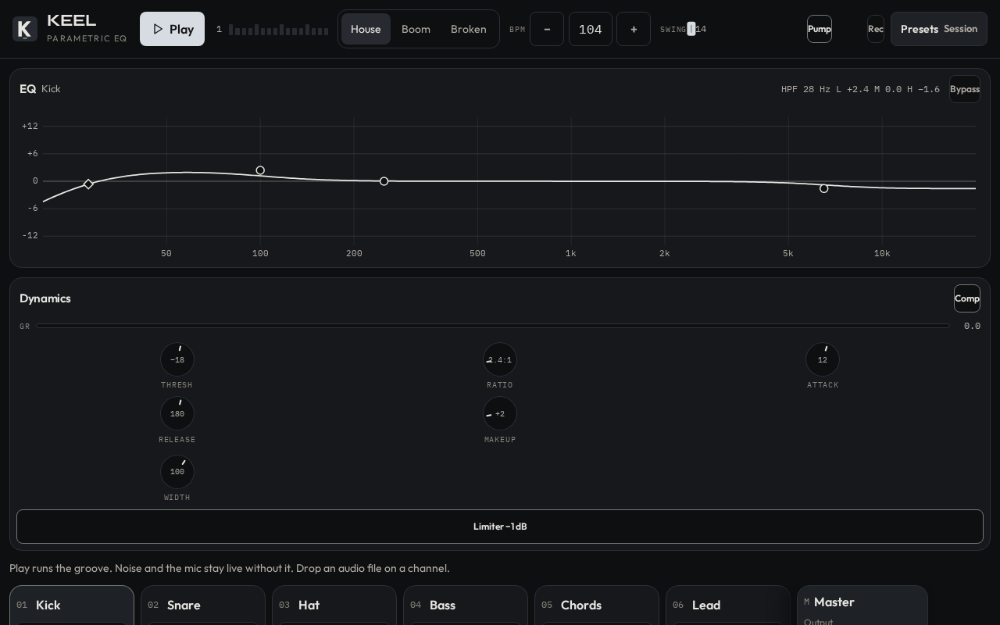

# KEEL

A six-channel mixing console in the browser — parametric EQ, dynamics, and a built-in groove. Load your own audio onto channels, shape each one, save scenes, and export/import mixes.

Built with React 19, Vite, TanStack Start/Router, Tailwind CSS 4, and a Web Audio engine. Originally built in Grok App Builder.



## Quick start

One command installs everything and starts the app:

```sh
./install.sh
```

Then open **http://localhost:8080** in your browser.

Prefer to do it by hand?

```sh
npm install
npm run dev
```

## Requirements

- **Node.js 20 or newer** (check with `node --version`)
- npm (comes with Node)

No database, accounts, or API keys needed to run it locally — mixes save in your browser.

## What it does

- **Six channels** — each with fader, pan, mute/solo, and level metering
- **Parametric EQ** — per-channel EQ graph you can drag
- **Dynamics** — per-channel compressor/gate controls
- **Built-in grooves** — house, boom, and broken-beat patterns to jam over
- **Load audio** — drop your own files onto channels
- **Scenes & mixes** — save scenes in the browser, export a mix to a file, import it back later

## Scripts

| Command | What it does |
|---|---|
| `npm run dev` | Start the dev server on http://localhost:8080 |
| `npm run build` | Production build (plus database migrations) |
| `npm run preview` | Serve the production build locally |
| `npm run typecheck` | TypeScript check |
| `npm run test` | Run the test suite |
| `npm run lint` | Lint the codebase |

To build without starting the server:

```sh
./install.sh --build
```

## Deploy

The repo is ready for [Vercel](https://vercel.com) — import it, and Vercel picks up the settings from `vercel.json`. No environment variables are required for the default setup (sign-in is off; see below).

## Configuration

- **Sign-in is off by default** for local runs (`.grok/app-env.json` sets `VITE_AUTH_ENABLED=false`). Set it to `"true"` and wire up the auth provider to turn accounts on.
- The app listens on port **8080** — change it in `vite.config.ts` if that port is taken.

## Project layout

```text
src/
  routes/            TanStack Start routes (the console lives at /)
  components/
    console/         Desk, channel strips, EQ graph, dynamics, meters
    ui/              Shared UI primitives (Radix + Tailwind)
  lib/
    audio/           Web Audio engine, grooves, file loading
    console-model.ts Console state, scenes, save/load
    auth/            Sign-in (opt-in, off by default)
server/              Server middleware and PWA helpers
scripts/             Dev, build, preview, and QA helpers
migrations/          Database migrations (used when auth/db are on)
```

## License

MIT — see [LICENSE](LICENSE).
